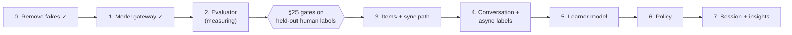
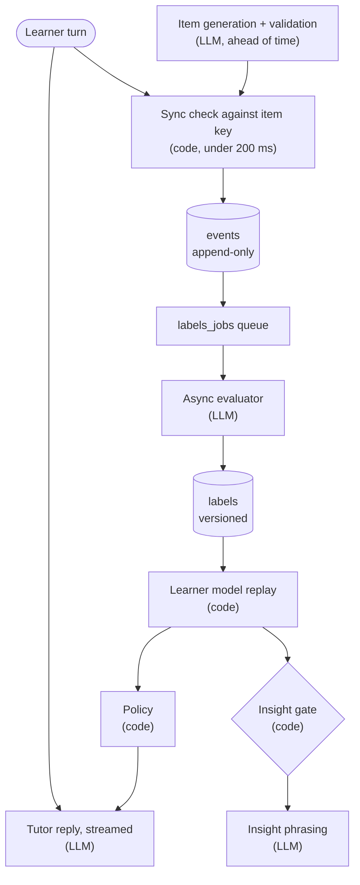

# Glotty AI-First Rebuild Plan

Oct 19, 2026 · @Illia Herashchenko

Glotty is being rebuilt so that a measured LLM evaluator comes first, and nothing is built on top of it until it passes the §25 gates. Steps 0–2 are done; step 2 is built but not yet measured against human labels.

> **Where this comes from.** The session where the plan was first proposed (session\_01LC2ewUc9hmqQxJ55PMB4UP) no longer exists, so its transcript can't be retrieved. This plan is rebuilt from what that session left in the repo: `REVIEW.md` (its "Suggested path back"), the README status table, the rebuild commit (2998fa0), and `Glotty_Concept.md` §21–§26 and §49. Wording from the original conversation that never reached the repo is lost.

## Why rebuild

The first implementation reported "all acceptance gates passed", but no real evaluator had ever been measured. The §49 build order was reversed: about 1,900 lines went into demo dashboards while the evaluator was simulated.

| Problem | What the code did |
| --- | --- |
| Rigged benchmark | `evaluateSimulated()` matched substrings copied from the 26 gold sentences. That gave 100% accuracy; rewording an error turned it into "uncertain". |
| Dead model | The live path called the retired `gemini-1.5-flash`, so it silently fell back to the simulator |
| No gold set | 26 invented sentences, no annotators, no κ, no held-out split; PI.07 and PP.06 had zero items |
| Bypassed insight gate | Posterior faked as `0.65 + n*0.08`; counter-hypothesis probe never run |
| Mutable event log | No revoke on `events`; the demo journey deleted events on every call |
| Inverted sync/async split | LLM awaited inside the request; sync result discarded; no answer keys |
| Weak learner model | Hardcoded weights, ordering clamp undone on next update, no pooled prior |
| Unusable exploration data | Invented propensities, no control cohort, explanation style not logged |
| No auth | Routes trusted `userId` from the request body |

## What AI-first means here

The LLM writes everything the learner reads and interprets everything the learner writes. Learner state, the insight gate, the policy and the event log are deterministic code. **The LLM proposes and reads; the code decides and records.**

- **No silent fallback.** A model failure is a thrown error. The caller decides whether it means uncertain, retry later or abort. Nothing is ever simulated or scored offline.
- **Measured before used.** No evaluator version ships without a full held-out report (§25). Prompt iteration happens on `dev` only.
- **Provider-agnostic.** Product code asks for a tier (`fast`, `strong`), never a model. Tiers map to model refs through the environment.
- **Versioned labels.** Every judgement records `evaluator_version` (prompt hash + taxonomy + model ref), so history can be re-scored later.
- **Raw evidence is immutable.** The `events` table is append-only, enforced by a trigger. Conclusions live in derived, versioned tables.
- **Abstain rather than accuse.** A false "you're wrong" is the worst error (§23). An "incorrect" verdict below 0.7 confidence becomes UNCERTAIN, and unmapped codes become UNKNOWN.
- **Policy lives in code.** Rules like the abstention threshold sit in post-processing, not in the prompt.

## Build order and status

Steps 0 and 1 are done, and step 2 is being measured. Steps 3–7 wait behind the evaluator gate, following the §49 dependency order.

## Step details

Each step's exit criterion is a measurement or a structural guarantee, not a demo.

| Step | Scope | Exit criterion |
| --- | --- | --- |
| 0. Remove fakes | Delete the simulated evaluator, scripted journey, demo dashboards and fake default user. Make `events` append-only. | Nothing in the codebase produces a label without a real model call. Done. |
| 1. Model gateway | `src/lib/ai`: tiers, Cloudflare Workers AI + any OpenAI-compatible endpoint, zod-validated output, one retry on invalid JSON | Unit tests against a mocked fetch; every candidate model answers `ai:ping`. Done. |
| 2. Evaluator | `prompts/evaluator/v4.md` (earlier versions kept for traceability), taxonomy with negative examples, abstention, UNKNOWN; gold tooling (`/annotate`, dev/held-out split, generator, bench) | All six §25 gates pass on the held-out human-labelled set. Built, not yet measured. |
| 3. Items + sync path | Generated items stored with answer keys and distinguishing probes; sync evaluation by key matching (§22) | Sync path p95 under 200 ms with no LLM call. |
| 4. Conversation + async labels | LLM conversation turns; evaluation moved to a background queue; versioned `labels` table (events → labels → learner state) | The learner never waits on the LLM; any label can be re-scored by version. |
| 5. Learner model | Built from labels: §16 weights (uncertain ≈ 0.1), ordering constraint flagged rather than clamped, pooled prior (§17) | Learner state reproducible from events by replay; real gate inputs. |
| 6. Policy | Rule-based policy driving the tutor; real propensities; control cohort assigned at sign-up; explanation style randomized and logged; auth from session | Logged data usable for causal analysis (§27–§30). |
| 7. Session + insights | Session framing, visible model, insight phrasing, "this is wrong" feedback loop, global circuit breaker (§11) | Insights fire only through the real gate with a probed counter-hypothesis (§9). |

The demo dashboards stay frozen until steps 1–6 pass.

> **Proposed design.** The sections from here to the data-flow diagram are my proposal for finishing step 2 and building steps 3–7. They follow `Glotty_Concept.md` and what is already in the repo, but they are not recovered from the lost session. Section references (§) point to the concept doc.

## Finishing step 2: from screen to passing gates

Step 2 is done when one model and prompt version passes all six §25 gates on held-out human labels. The binding constraint is the gold set, not the model.

1. **Shortlist from the screen.** Keep three models: the best on precision on INCORRECT, the best on latency per accuracy point, and one from a different family as a hedge. A screen against generator intent can rule a model out; it can't qualify one.
2. **Build the gold set to a minimum viable size.** Target 300 items per cluster before the first held-out report (600 eventually, §24). At least half should be real learner writing, and the held-out split is real learner writing only (§24). Recruit through a B1 class or tutoring platform, using the same prompts the tutor will ask. Oversample hard negatives and ambiguous cases.
3. **Two annotators from the start.** One linguist plus one experienced Spanish teacher, labelling independently, with a third person adjudicating disagreements. Measure κ every 100 items. If κ for a code is below 0.60, rewrite that code's definition and probe before labelling more items for it.
4. **Iterate on `dev` only.** Prompt changes are versioned (`evaluator/v2.md` …). Each change gets a bench run and a one-line entry in a prompt changelog: what changed, which gate moved.
5. **Two-tier routing if one model can't pass alone.** The fast model screens. Anything it marks incorrect, uncertain, or below 0.85 confidence goes to the strong model. The bench measures that routed pair as one evaluator version.
6. **Report held-out once per candidate version,** and freeze it. If it fails, go back to dev with a new version number; never re-tune against held-out.

If no version reaches precision on INCORRECT ≥ 0.95 after three prompt rounds with routing, that triggers the stop rule in Risks below.

## Step 3: items, answer keys and the sync path

The LLM writes items ahead of time, and code checks them before any learner sees one. That makes a sub-200 ms verdict possible without a model in the request (§22, §45).

**Item types for the MVP,** from most to least constrained:

| Type | Example | Sync verdict from |
| --- | --- | --- |
| Choice | Pick *iba* or *fui* in a sentence | Exact key |
| Cloze | Fill in the verb, infinitive given | Key set of normalized forms, accent-tolerant |
| Transform | Rewrite a sentence as background narration | Key set plus a morphology check of the target verb |
| Constrained production | One sentence that answers the prompt using *por* or *para* | Sync is structural only (target word present); correctness is async |
| Free narrative | Tell what happened | Async only |

**Every item stores** its prompt, the concept and taxonomy codes it tests, the answer key (all acceptable forms), a distractor-to-code map (which wrong answer signals which misconception), the generator version, and a validation record.

**Validation at generation time.** The strong model drafts the item. A second, independent evaluator call must agree with every key and distractor label. Morphology (spaCy `es_core_news_md`) confirms each keyed form's tense and person. Any disagreement discards the item rather than patching it.

**Distinguishing probes.** For each pair of neighbouring codes (PP.01 vs PP.06, PI.04 vs PI.01, …), generate items where the two hypotheses predict different wrong answers. These are what the insight gate's counter-hypothesis check runs on (§9).

**Concept graph and diagnostic first.** Bring `data/graph` from 34 to about 40 nodes and give each node its applicable diagnostic codes, item-pool reference and prerequisite closure (§18, Appendix C); items hang off these nodes. Then build the diagnostic: a short item set that places a new learner in the population prior (§12, §17), logged as `diagnostic_item` events.

**The sync verdict** is correct, incorrect or unscored (Appendix A's enum), with `eval_path: "sync"`. Unscored is never shown as wrong; it queues the response for async evaluation. An item whose key is contradicted by the async evaluator more than twice gets pulled for review.

**Exit:** sync p95 under 200 ms on 1,000 synthetic responses; key precision ≥ 0.99, checked by the async evaluator plus a human sample of 200.

## Step 4: conversation and async labelling

The tutor converses through the LLM, but no learner turn waits on evaluation. The turn writes an event; a worker labels it later; labels live in their own versioned table (§35).

**Conversation turn** (p95 under 1.5 s, streamed). The orchestrator builds the prompt from the session plan, the last few turns and the learner's current hypotheses. Until step 6 exists, a fixed session script stands in for the plan. The tutor replies in Spanish at the learner's level and recasts rather than corrects, unless the policy chose a correction action.

**Clarifying questions** (§23). When the evaluator abstains and returns a clarifying question, the label stays UNCERTAIN. The question becomes a candidate action for the policy rather than being asked automatically.

**Event write.** Each learner turn is one immutable event: raw text, response latency, item ID if any, the sync verdict if any, and policy fields. `latency_ms` means the learner's response time only. Policy fields are NOT NULL from the first event (§33), so no real learner uses the product before step 6. Internal test traffic logs a fixed policy with propensity 1.

**Async queue.** A Postgres-backed job table (`labels_jobs`, claimed with `FOR UPDATE SKIP LOCKED`), so there's no new infrastructure. Workers batch by model and call the evaluator through the gateway. Target: under 60 s from event to label.

**`labels` table.** Columns: `event_id`, `evaluator_version`, evaluation, confidence, diagnosis code and confidence, error span, `created_at`. Many labels per event, one per version. A view picks the current version, so re-scoring history is a backfill job, not a migration.

**Failures.** A gateway error leaves the job retryable with backoff. After three failures the event gets an explicit `unlabeled` status. It never gets a guessed label.

**Exit:** a 20-turn scripted conversation shows zero evaluator calls in the request path; every event is labelled within 60 s; re-scoring 1,000 events under a new evaluator version works end to end.

## Step 5: learner model from labels

Learner state is a pure function `replay(events, labels@vE, model@vM) → state`, snapshotted daily and never edited by hand (§35). Two quantities per learner, per concept, per kind of knowing (§14):

- **Mastery:** Bayesian knowledge tracing per (concept, level), for recognition, recall and spontaneous production. BKT is simple, calibrated and debuggable (§17).
- **Retention:** FSRS stability and difficulty per concept, fed only by retrieval events (items after a gap).

**Evidence weights** are written on each event, as Appendix A requires (\`evidence\_weight NOT NULL\`), and replay may recompute them under a new model version:

| Evidence | Weight |
| --- | --- |
| Controlled item, confident label | 1.0 |
| Same, after a long gap (7+ days is my assumption) | 1.2 |
| Constrained production | 0.8 |
| Reading comprehension check | 0.6 |
| Free conversation | 0.4 |
| Any UNCERTAIN label | 0.1 |

**Ordering constraint.** Production implies recall implies recognition. Fit with the constraint as a projection step, and log every violation as a flag ("produces X but fails recognition"). Violations go to a review queue, not into the fit.

**Pooled prior.** A new learner starts at the population posterior for their diagnostic profile. Begin with 3–5 hand-defined profiles from the diagnostic; replace them with a fitted hierarchical model once 200+ learners exist. The schema stores `prior_version` from day one, so this swap needs no migration.

**Misconception posterior.** For each taxonomy code: P(code | labels). Count only independent, confidently labelled observations, and track the activity types and sessions they span. These are exactly the insight gate's inputs (§9).

**Exit:** replay is deterministic (same inputs give a byte-identical state); backtest calibration on held-out next responses has a Brier score better than the population-only prior. The concept's Phase 3 baselines (last-observation, fixed-interval, reliability diagrams; Appendix D) are later gates.

## Step 6: policy, exploration and causal logging

A rule-based policy picks each next activity from learner state; exploration and propensity logging are on from the first user (§29). The LLM then renders the chosen activity; it never chooses it.

**Actions** (§27): review, explain, contrast, produce, read, conversation, introduce, retrieve, nothing. Listen waits for speech, which is out of MVP scope.

**Scoring.** Each candidate gets a hand-written value from learner state. For example: expected gain on the 14-day spontaneous-production objective (§28), FSRS retrievability for retrieve, and an unresolved counter-hypothesis for a probe item. The rules live in one versioned module, so `policy_version` is meaningful.

**Hard constraints before scoring:**

- About 40% of session time goes to input (reading texts chosen by predicted comprehension; conversation doesn't count). This share is itself an experimental arm (§31).
- No action across a difficulty gap the learner isn't ready for (§30).
- At most two exploratory actions in a row, and the correctness of feedback is never randomized.
- Session 1: only explanation style is randomized.

**Exploration.** Near-ties (within 0.05 of the best value) are chosen uniformly. Explanation style is randomized per explanation. Scheduling jitter of ×0.7 / 1.0 / 1.4 applies to 10% of reviews. The logged propensity is the product of every random choice that led to the action.

**Control cohort.** 10% of learners are assigned at sign-up, permanently: a strong fixed sequence over the same clusters with FSRS review, not a strawman (§44).

**Logged on every event:** `policy_version`, `policy_candidates` with their values, `propensity`, `is_exploration`, `cohort`, `explanation_style`. Policy version and explanation style need new additive columns, because Appendix A lacks them. User ID comes from the auth session, never from the request body.

**Exit:** an offline replay of 1,000 simulated decisions shows propensities summing to 1 per decision; an inverse-propensity-weighted estimate recovers a planted effect in simulation.

## Step 7: sessions, insights and the feedback loop

A session has a planned shape (§41, §43). An insight is shown only when the deterministic gate passes, and only phrasing is left to the LLM.

**Visible model** (§39). The learner sees their estimates with uncertainty ("probably weak, but only six attempts") and can dispute them. A dispute is an event and goes to review.

**Session shape** (about 20 minutes):

1. Opening: the policy's plan for today, phrased by the LLM from a structured plan, plus continuity from last time.
2. Conversation with silent observation.
3. Targeted practice chosen by the policy, including any pending counter-hypothesis probes.
4. Re-test: fresh production on the same concept.
5. Close: what Glotty learned today and what comes next. This is precomputed while the session runs, so it renders in under 5 s.

**Insight gate** (§9), computed in code from step 5's posterior: posterior ≥ 0.75, 4+ independent observations, 2+ activity types, 2+ sessions, a probed counter-hypothesis, and each supporting label at confidence ≥ 0.7. The LLM gets the passing record (code, evidence, counter-hypothesis result) and may only phrase it. Hedged below p = 0.85, unhedged above (§10). A check confirms the phrasing names the gated code and no other.

**Cold start** (§12): sessions 1–2 show a calibrated starting hypothesis and observations about the language, never about the learner.

**Feedback.** Every insight carries useful / not useful / this is wrong, each logged as an event. "This is wrong" sends the insight and its evidence to human review.

**Global circuit breaker** (§11): if wrong ratings exceed 3% of surfaced insights over a rolling 200, insight surfacing stops for everyone and the gate thresholds rise until a review clears it. If useful ratings fall below 50%, the feature gets a design review.

**Exit:** a first-session usability test with 5–8 real B1 learners; zero insights surfaced in session 1; every surfaced insight traceable to its gate record. Phase 1 also requires at least 60% of learners to get a gate-passing insight by session 3 (Appendix D).

## Data flow at a glance

Only four boxes call an LLM. The learner never waits on any of them except the tutor's streamed reply. Every decision that changes what the learner sees or what is recorded about them is code.

## Risks and stop rules

Each risk has a measurable trigger, decided now, so that sunk cost doesn't decide later.

| Risk | Trigger | Response |
| --- | --- | --- |
| Free-form evaluation can't reach the gates (§50) | Precision on INCORRECT < 0.95 on held-out after 3 prompt rounds with routing | Narrow scope: async diagnosis only on constrained production; free conversation feeds the model at 0.4 weight and never triggers correction |
| Humans can't agree on a code | κ diagnosis < 0.60 on a code after one rewrite | Merge or drop the code; taxonomy v2 |
| Gold set never gets real learner data | Under 50% real items when step 2 is due | Pause step 3 and fix recruitment first; synthetic-only gold doesn't count |
| Workers AI model retired or changed | Ping fails or bench drops > 3 points after a provider change | Gateway already provider-agnostic: re-bench the shortlist, bump the evaluator version, re-score |
| Cost per session over budget (§45) | > $0.60 per session at 30 turns | Route more traffic to the fast tier; batch async labels; cache item generation |
| Adaptation doesn't beat good static sequencing | Phase 1 experiment (§44: two arms, \~90 learners each, 6 weeks, blind-scored) misses its pre-registered threshold (my proposal for it: d < 0.2) | Ship as a strong static curriculum plus diagnosis; don't build the learned policy |
| Wrong insights | Circuit breaker trips twice in 30 days | Raise gate thresholds permanently; review probe items |

The first row is the most important and the cheapest to answer: it is what step 2 exists to find out. The Phase 1 gate that decides whether the product exists comes later: if fewer than 60% of learners get a gate-passing insight by session 3, revisit the clusters, the gate or the thesis (Phase 1).

## Evaluator measurement

The evaluator ships only when all six gates pass on the held-out split of a human-labelled gold set. Binary and diagnosis accuracy are always reported separately.

| Metric | Gate |
| --- | --- |
| Inter-annotator κ, binary correctness | ≥ 0.75 |
| Inter-annotator κ, diagnosis code | ≥ 0.60 |
| Binary accuracy (held-out) | ≥ 0.90 |
| Precision on INCORRECT | ≥ 0.95 |
| Diagnosis top-1, given INCORRECT | ≥ 0.65 |
| UNCERTAIN rate | ≤ 15% |

Workflow:

1. **Draft candidates.** `npm run gold:generate` writes synthetic B1 responses. The generator's intended labels go to a separate file that annotators never see.
2. **Annotate** at `/annotate`, following `data/gold/GUIDELINES.md`. Add real learner writing: §24 wants 400–600 real responses per cluster, and synthetic items are only a bootstrap.
3. **Benchmark** with `npm run bench` on `dev`; iterate prompts there only. Run `--split heldout` to report.
4. **Agreement.** A second independent annotator turns κ from "not measurable" into a real number. Until then, results are provisional.

Before any annotation exists, `--against intent` screens models against the generator's unreviewed labels. That is a screen, not a gold measurement.

## Model selection status

All 13 Workers AI candidates in `src/lib/ai/config.ts` now return valid evaluator verdicts. The tiers are now set in the environment: **fast = `gpt-oss-20b#low`, strong = `kimi-k2.6#none`** (`GLOTTY_MODEL_*` plus `GLOTTY_EFFORT_*`).

A screen of all 13 on 84 dev items (2026-10-19, prompt v1, scoring before 9ea1926) found no model that passes accuracy or precision on INCORRECT. That result is against the generator's unreviewed labels, not gold.

| Model | Accuracy | Precision INCORRECT | Diagnosis top-1 | Uncertain | False accusations | Failed calls | p50 / p95 s | Tokens in / out |
| --- | --- | --- | --- | --- | --- | --- | --- | --- |
| llama-4-scout-17b | 0.761 | 0.941 | 0.750 | 0.036 | 1 | 0 | 12.1 / 16.3 | 2643 / 188 |
| kimi-k2.6#none | 0.790 | 0.895 | 0.765 | 0.071 | 2 | 0 | 7.1 / 11.1 | 2840 / 184 |
| glm-5.3#low (re-run, concurrency 2) | 0.775 | 0.895 | 1.000 | 0.012 | 2 | 0 | 6.8 / 50.0 | 2709 / 198 |
| qwen3.8-27b#low | 0.797 | 0.900 | 0.833 | 0.000 | 2 | 3 (HTTP 500) | 27.1 / 90.8 | 2787 / 773 |
| gemma-4-26b-a4b-it | 0.838 | 0.875 | 0.905 | 0.013 | 3 | 4 (budget) | 16.7 / 49.0 | 2763 / 1150 |
| deepseek-v4-flash#low | 0.836 | 0.864 | 0.895 | 0.000 | 3 | 10 (budget) | 11.2 / 35.8 | 2784 / 902 |
| gpt-oss-20b#low | 0.727 | 0.850 | 0.706 | 0.000 | 3 | 0 | 3.1 / 5.2 | 2696 / 215 |
| glm-5.3-flash#low | 0.786 | 0.833 | 0.950 | 0.012 | 4 | 0 | 13.8 / 32.1 | 2709 / 180 |
| qwen3-30b-a3b | 0.803 | 0.833 | 0.650 | 0.048 | 4 | 0 | 5.8 / 15.1 | 2797 / 811 |
| deepseek-v4-pro#low | 0.824 | 0.826 | 0.895 | 0.037 | 4 | 2 (budget) | 15.3 / 59.1 | 2784 / 852 |
| gpt-oss-120b#low | 0.794 | 0.793 | 0.696 | 0.000 | 6 | 0 | 5.3 / 14.9 | 2690 / 343 |
| llama-3.3-70b (former strong) | 0.757 | 0.710 | 0.864 | 0.000 | 9 | 0 | 4.7 / 7.2 | 2800 / 154 |
| mistral-small-3.1-24b | 0.750 | 0.639 | 0.739 | 0.000 | 13 | 0 | 5.6 / 8.1 | 2742 / 171 |

Sorted by false accusations. Gates: accuracy ≥ 0.90, precision ≥ 0.95, diagnosis ≥ 0.65, uncertain ≤ 0.15. "Budget" = reasoning used all 4,096 tokens. Many top-ranked "false accusations" are generator mislabels (for example, `Siempre visité el Louvre…`, labelled ambiguous, is a real PI.04 error). Differences of one or two items are noise at this size.

**Prompt v2 and the scoring fix** (9ea1926). The table above scores a `not_applicable` verdict on an applicable item as neither right nor wrong, so a model could skip items and raise its accuracy; gpt-oss-20b did this on 21 of 84 items. Since 9ea1926 such a verdict counts as a miss, and the report has a "Wrong N/A" column. Prompt v2 tightens four rules: scene-setting clauses in a narrative need the imperfect (PI.06), a speaker's doubt about facts is not intent ambiguity, missing accents don't change the tense judged, and any preterite/imperfect form or *por*/*para* makes a response applicable. Screen of the two tiers under the new scoring:

| Model | Prompt | Accuracy | Precision INCORRECT | Diagnosis top-1 | Uncertain | False accusations | Wrong N/A |
| --- | --- | --- | --- | --- | --- | --- | --- |
| gpt-oss-20b#low | v1 | 0.500 | 0.762 | 0.750 | 0.000 | 5 | 21 |
| gpt-oss-20b#low | v2 | 0.716 | 0.773 | 0.706 | 0.000 | 5 | 2 |
| kimi-k2.6#none | v1 | 0.764 | 0.875 | 0.762 | 0.036 | 3 | 4 |
| kimi-k2.6#none | v2 | 0.778 | 0.821 | 0.826 | 0.024 | 5 | 4 |

v2 fixed the cases it targeted, but kimi gained two new false accusations, one probably from the PI.06 rule. Still a screen against generator intent, not gold.

**Prompt v3** adds one scope decision: a *por* or *para* where Spanish needs a different preposition or none at all (*Estoy buscando para mis llaves*) is a por/para error, coded PP.06 when English "for" explains it. The same rule is in `GUIDELINES.md`, `data/gold/rules.json` (`PREP-NEITHER`) and the model-labelling instructions (version 3).

**Prompt v4** narrows that rule to a *por*/*para* with no valid reading at all (destination, cause, duration and other standard uses stay valid), and notes that an unaccented *hacia* is usually *hacía*. v3 had produced false accusations on *Salimos para la estación*, *Las dejo por compasión* and *jugaba… y hacia ejercicio*.

**Gateway fixes from real-world testing** (pushed in 2e49b20):

- Reasoning models (gemma-4, glm, kimi, deepseek-v4) spent the whole token budget thinking and returned empty content. The gateway now reads `finish_reason`, reports that cause clearly, and never retries into the same limit.
- A `#effort` suffix on a model ref (for example `gpt-oss-120b#low`) sends `reasoning_effort`. The suffix is recorded in the evaluator version. It cut kimi-k2.6 from 59 s to 6 s per call.
- The answer is never taken from the reasoning field. Workers AI's qwen3-30b with `#none` puts its JSON there, so `#none` is not used for that model.

| Excluded model | Why |
| --- | --- |
| gemma-3-12b-it | HTTP 403: no longer served to this account |
| eurollm-9b-it | Listed, but every call fails with "model does not have config" |
| nemotron-3-120b-a12b | HTTP 408 timeouts; 84 s for a 400-token reply |
| glm-4.7-flash | Reasoning exhausts the budget; rejects `reasoning_effort=none` |

**Generator quality.** The first generator prompt produced mislabelled items, meta-text leaking into responses ("…falta un acento en el nombre del pueblo") and repetitive topics. The new prompt fixes the structure: a kind plan, rotating topics, and a rationale that must name the correction. With llama-3.3-70b as the generator, about 15 of its 90 intended labels still look wrong. The gold pool is 116 items: those 90 plus 26 legacy items. Treat them as drafts for annotators.

## Open decisions and next actions

The critical path is human annotation. No model choice is final until the gold set exists.

- [x] Rename the secret `CLOUDFLARE_AI_TOKEN` to `CLOUDFLARE_API_TOKEN` in the cloud environment. Done: `CLOUDFLARE_API_TOKEN` is set.
- [x] Pick fast and strong tiers: fast = `gpt-oss-20b#low`, strong = `kimi-k2.6#none`, set through the environment (no built-in defaults).
- [ ] Regenerate gold candidates with the chosen strong model if it beats llama-3.3-70b. The current 90 generated items have about 15 dubious intended labels.
- [ ] Annotate the 116 candidates at `/annotate`, and add real learner writing. In progress: 49 of 116 labelled (`data/gold/annotations/illia.jsonl`).
- [ ] Re-check Incorrect labels against `GUIDELINES.md`: errors outside the two clusters (gender, vocabulary, other prepositions, word order) are labelled Correct, and in-cluster errors get a code where one fits rather than `UNKNOWN`.
- [x] Label all items with ChatGPT (`npm run gold:model-export`, then `gold:model-import`) and check agreement with the human labels (`gold:model-compare`). Result: κ 0.29–0.31 between human and ChatGPT, 0.90 between two ChatGPT runs.
- [ ] Settle the human/ChatGPT disagreements at `/adjudicate` by rule (`data/gold/rules.json`); benchmark on consensus gold with `npm run bench -- --consensus chatgpt-v2`. Provisional: no native speaker is available yet.
- [ ] Look into native-corrected learner corpora (e.g. COWS-L2H, CAES) and answer-keyed exercise sets as a source of native judgments; check licences first.
- [ ] Native-speaker check of the gold set before any held-out result counts as a pass.
- [ ] Recruit a second qualified annotator (a linguist, §48) so κ can be measured.
- [ ] Have annotators check PP.04 items first: the generator marks duration-por ("estuve por tres horas") as an error, though the taxonomy accepts it.
- [ ] Once a model passes on `dev`, run `--split heldout` once and report it. Then start step 3.

## Concept check

I checked the plan against all of `Glotty_Concept.md`, including Appendices A–D. The core holds: gateway, measured evaluator, events → labels → state, gate, exploration. I found eight conflicts and six gaps; a ninth conflict (model labels instead of a second human) was added later by decision. Four conflicts are deliberate divergences, kept with their reasons in the table; the other eleven items are fixed in the sections above.

| Concept says | Plan had | Now |
| --- | --- | --- |
| §49: conversation and insight surfacing come after learner model and policy | Conversation in step 4 | Kept as a divergence. §49 guards against demoing on an unmeasured evaluator; by step 4 the evaluator has passed its gates, and only internal testers use conversation until step 6 |
| §33, App. A: policy fields NOT NULL from the first event | Policy only at step 6 | No real learners before step 6; test traffic logs a fixed policy, propensity 1 |
| App. A: `evidence_weight` stored on every event | Weights applied only in replay | Stored on the event; replay may recompute under a new model version |
| §24: gold set from real learner production | "At least half real" | At least half real overall; held-out split real only |
| §31: input budget is reading/listening | Counted conversation as input | Reading only, texts by predicted comprehension |
| App. D Phase 3: beat last-observation and fixed-interval baselines, with reliability diagrams | Brier vs population prior | Kept as a divergence: Brier vs prior is the step 5 exit; the Phase 3 baselines are later gates |
| §24: two independent human annotators per item | Two humans on every item | Kept as a divergence: an external model (ChatGPT) labels all items; one human labels a random sample. If model and human agree at the human bar (κ ≥ 0.75 evaluation, ≥ 0.60 diagnosis), model labels drive prompt iteration on `dev`. Held-out reports stay human-labelled. |
| §44: pre-registered success threshold | Invented "d < 0.2" | Kept as a divergence: d < 0.2 is my proposal for the pre-registered threshold |
| App. A: evaluation enum is correct / incorrect / uncertain / unscored | Invented NO\_KEY\_MATCH | `unscored` |
| §18, App. C: \~40-node graph; nodes carry codes, item pools, prerequisite closure | Missing (repo has 34 bare nodes) | Added to step 3 |
| §12, §17: a diagnostic places new learners in the prior | Missing | Added to step 3 |
| §39: visible model with uncertainty, disputable | Missing | Added to step 7 |
| App. D: ≥ 60% of learners get a gate-passing insight by session 3 | Missing | Step 7 exit and Risks |
| §30: never randomize the correctness of feedback | Missing | Step 6 constraints |
| §23: ask when intent is ambiguous | Missing | Step 4: clarifying question becomes a policy candidate |

**Already matching, verified in the repo:** the `events` table mirrors Appendix A field for field, and immutability uses triggers plus a revoke. The taxonomy has a distinguishing probe and intervention family for all 16 codes (§26). The §9 gate thresholds, §10 hedging, §11 budget and breaker, §16 weights, §22/§45 latency budgets and §25 gates match the plan.

**My additions, not in the concept:** two-tier evaluator routing (§45 supports the idea), the Postgres job queue, the 7-day "long gap", the 0.05 near-tie margin, spaCy for morphology, the stop-rule thresholds, and the new columns for policy version and explanation style (additive, as §33 allows). All are proposals to tune.

**Correctly left out (§42):** speech and listening, Parquet and DuckDB (Phase 2), and the learned policy (Phase 4).

**README:** the repo's step table already matches this plan's order, so it needs no change.
